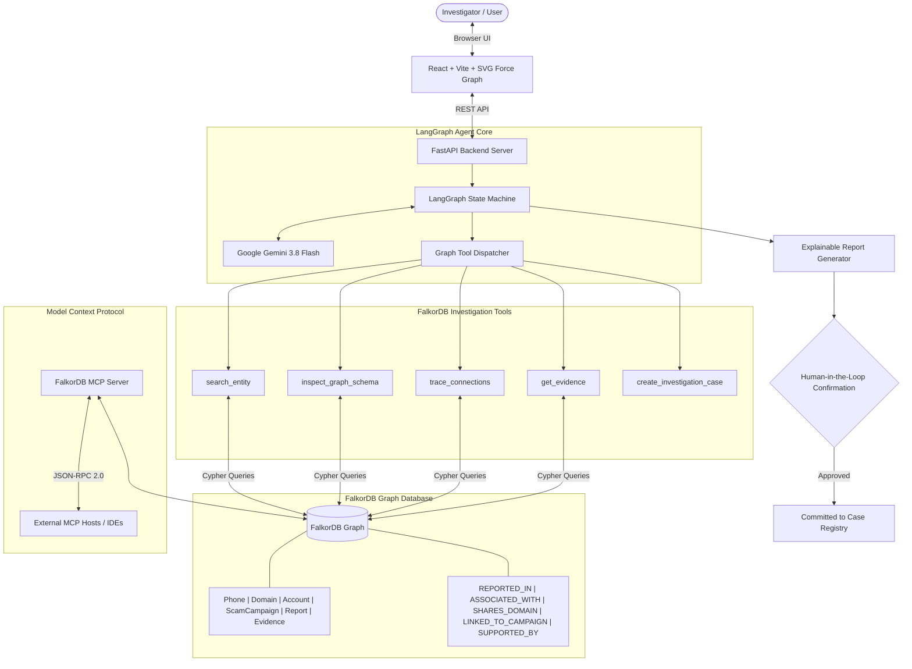

# ScamTrace — Graph-Powered AI Scam Investigation Agent

> **FalkorDB Graph Hacks Hackathon — Track 01: Agents That Act on Connected Data**  
> An AI cyber-fraud investigation agent that reasons over connected graph data using multi-hop Cypher traversal in **FalkorDB** to uncover hidden scam syndicates, bulletproof hosting, and crypto laundering accounts.

---

## 1. Product Overview & Problem

Most conventional scam detection tools classify a phone number, URL, message, or crypto wallet in isolation:
- A spam filter flags a single phone number as "unwanted robocall".
- A URL scanner checks a domain against a blocklist.

**The Reality:** Modern cyber fraud is perpetrated by coordinated syndicates operating multi-tiered infrastructure. A throwaway VoIP phone number sends phishing SMS alerts; those alerts funnel victims to lookalike phishing domains; those domains share co-located bulletproof hosting IP infrastructure with credential harvesters; stolen funds are immediately channeled into centralized crypto laundering mule wallets.

**ScamTrace** investigates **relationships** rather than isolated strings. When an investigator submits a suspicious identifier:
1. The **LangGraph Agent** autonomously selects and invokes **FalkorDB graph tools**.
2. FalkorDB executes **multi-hop Cypher traversal** to follow relationship paths across reports, domains, accounts, and threat campaigns.
3. The agent retrieves **underlying cryptographic and forensic evidence** (SMS dumps, SSL certificate telemetry, on-chain ledger records).
4. The agent produces an **explainable, source-grounded investigation report** with calibrated evidence strength and proposes a controlled action requiring human approval.

---

## 2. Architecture Diagram



---

## 3. FalkorDB Graph Schema Design

ScamTrace models cybercrime threat networks using 6 core node types and 6 relationship types:

### Node Types
| Node Label | Key Properties | Description |
| :--- | :--- | :--- |
| `Phone` | `id`, `number`, `carrier`, `country`, `line_type`, `risk_score` | Telephony identifiers, SMS gateways, VoIP callback lines |
| `Domain` | `id`, `domain_name`, `registrar`, `creation_date`, `ip_address`, `risk_score` | Phishing landing pages, credential harvesters, reverse proxy IPs |
| `Account` | `id`, `account_id`, `platform`, `account_type`, `status`, `risk_score` | Crypto laundering wallets (Tron/USDT), Telegram bot exfiltration channels |
| `ScamCampaign` | `id`, `campaign_id`, `name`, `theme`, `severity`, `status` | Overarching threat campaigns (e.g. *Global Bank Phish & Drain Syndicate*) |
| `Report` | `id`, `report_id`, `source`, `reported_date`, `claim`, `verified`, `confidence` | Incident submissions from victim portals and state cyber centers |
| `Evidence` | `id`, `evidence_id`, `type`, `description`, `timestamp`, `hash_signature` | Forensic artifacts: raw SMS dumps, DNS/SSL telemetry, blockchain transaction hashes |

### Relationship Types
- `(:Phone | :Domain | :Account)-[:REPORTED_IN]->(:Report)`
- `(:Phone | :Domain | :Account | :ScamCampaign)-[:ASSOCIATED_WITH]->(:Domain | :Account | :Phone)`
- `(:Account | :Phone)-[:SHARES_DOMAIN]->(:Domain)`
- `(:Report | :Domain | :Account)-[:LINKED_TO_CAMPAIGN]->(:ScamCampaign)`
- `(:Report | :ScamCampaign | :Account)-[:SUPPORTED_BY]->(:Evidence)`
- `(:Report | :Evidence)-[:REFERENCES]->(:Report | :ScamCampaign | :Account)`

---

## 4. Essential Cypher Queries

### Multi-Hop Relationship Traversal (Up to Depth 4)
```cypher
MATCH p = (start)-[*1..4]-(target)
WHERE start.id = $start_id OR start.number = $start_id
RETURN p AS path, target, length(p) AS depth
```

### Forensic Evidence Retrieval
```cypher
MATCH (target)-[:SUPPORTED_BY]->(e:Evidence)
WHERE target.id = $target_id OR target.report_id = $target_id OR target.campaign_id = $target_id
RETURN e AS evidence, 1 AS hop_distance
```

### Shortest Relationship Path Between Two Entities
```cypher
MATCH (a {id: $src}), (b {id: $tgt}),
      p = shortestPath((a)-[*]-(b))
RETURN p
```

---

## 5. Three Prepared Hackathon Scenarios

ScamTrace includes 3 deterministically seeded demonstration scenarios accessible via one-click triggers in the dashboard:

### Scenario 1: Coordinated Phishing Syndicate (Multi-Hop)
- **Target Identifier:** `+1-800-555-0199`
- **What Happens:** The agent starts at a VoIP phone number. Traversing FalkorDB, it follows 4 hops:
  $$\text{Phone(+1-800-555-0199)} \xrightarrow{\text{REPORTED\_IN}} \text{Report(REP-10492)} \xrightarrow{\text{LINKED}} \text{Campaign(CAMP-CHASE-PHISH)} \xrightarrow{\text{ASSOCIATED}} \text{Domain} \xrightarrow{\text{REFERENCES}} \text{Account(ACC-CRYPTO-MULE-8831)}$$
- **Evidence Uncovered:** Raw phishing SMS metadata, bulletproof hosting IP reverse-lookup, on-chain blockchain transaction ledger ($24,500 transferred).
- **Outcome:** `HIGH_CONFIDENCE_MALICIOUS`. Recommended action: `ESCALATE_AND_FLAG`.

### Scenario 2: Sequential Similarity Non-Connection (Coincidental Numbers)
- **Target Identifier:** `+1-800-555-0144` vs `+1-800-555-0145`
- **What Happens:** Evaluates two phone numbers with sequential digits. Traditional string matching might assume they belong to the same call center. FalkorDB graph analysis proves they are completely independent: `+1-800-555-0144` belongs to Acme Health Clinic with 0 scam links.
- **Outcome:** `BENIGN_INDEPENDENT`. Confirms 0 connections, preventing false-positive accusations.

### Scenario 3: Insufficient Evidence / Ambiguous Lead
- **Target Identifier:** `+1-800-555-0720`
- **What Happens:** A caller with only a single unverified forum complaint ("hung up after 2 rings"). No connected campaigns, no shared infrastructure, 0 forensic artifacts.
- **Outcome:** `INSUFFICIENT_EVIDENCE`. Recommended action: `LOG_AND_MONITOR`. Demonstrates calibrated reasoning without hallucinated accusations.

---

## 6. Setup and Execution Instructions

### Prerequisites
- Python 3.11+
- Node.js v18+ and npm
- FalkorDB instance (Optional: local Docker `docker run -p 6379:6379 falkordb/falkordb` or FalkorDB Cloud. If offline, the built-in embedded Cypher engine activates automatically with zero configuration required!)

### 1. Environment Configuration
Copy `.env.example` to `.env`:
```bash
cp .env.example .env
```
Ensure your Google Gemini API key or FalkorDB credentials are configured:
```ini
GEMINI_API_KEY=your_gemini_api_key_here
GEMINI_MODEL=gemini-3.8-flash
FALKORDB_HOST=localhost
FALKORDB_PORT=6379
```

### 2. Backend Setup & Run
```bash
cd backend
python -m pip install -r requirements.txt
python -m uvicorn app.main:app --host 127.0.0.1 --port 8000 --reload
```
API Documentation will be live at: `http://127.0.0.1:8000/docs`

### 3. Frontend Setup & Run
```bash
cd frontend
npm install
npm run dev -- --host 127.0.0.1 --port 5173
```
Open `http://127.0.0.1:5173/` in your browser.

---

## 7. Model Context Protocol (MCP) Server

ScamTrace exposes its FalkorDB investigation tools via standard MCP JSON-RPC 2.0 over STDIO:
```bash
python -m app.mcp.server
```
Exposed tools:
- `falkordb_search_entity`
- `falkordb_inspect_schema`
- `falkordb_trace_connections`
- `falkordb_get_evidence`
- `falkordb_create_case`

---

## 8. Verification & Automated Test Results

Run all test suites:
```bash
# 1. FalkorDB Cypher Queries & Multi-Hop Traversal
python backend/tests/test_graph_queries.py

# 2. Agent Tools & Calibrated Scoring
python backend/tests/test_agent_tools.py

# 3. End-to-End REST API & Human Confirmation Flow
python backend/tests/test_api_scenarios.py
```
**Test Results:** 100% PASS across all graph queries, tool calling, and API scenarios.
